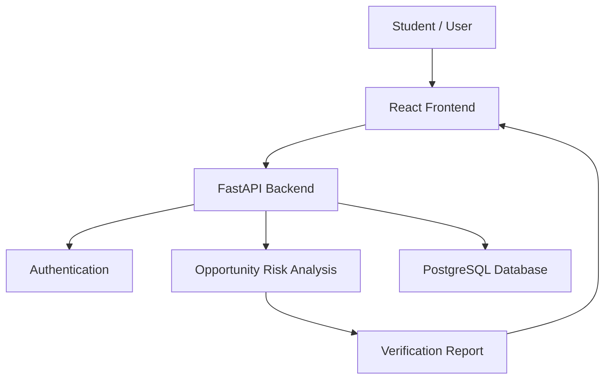
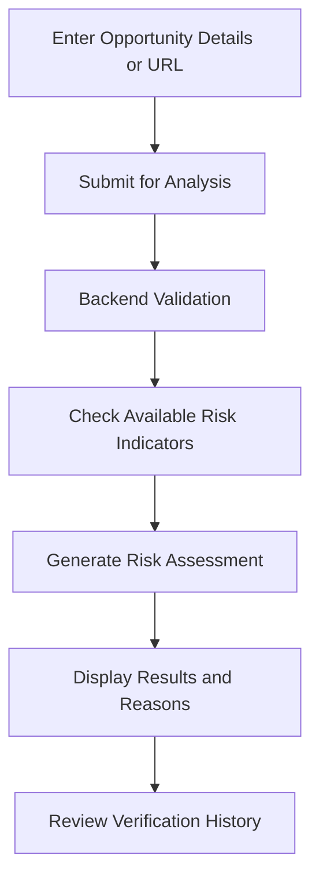

# 🛡️ OfferTrace

### Verify Before You Trust.

**OfferTrace** is a web application designed to help students evaluate internship and job opportunities by analyzing suspicious emails and URLs for potential scam indicators.

🎯 **Goal:** Help students make safer, more informed decisions before trusting an online opportunity.

---

## ✨ Key Features

* 🔍 **Opportunity Verification** — Analyze opportunity details, emails, and URLs.
* ⚠️ **Risk Analysis** — Identify potential warning signs using rule-based checks.
* 📊 **Verification Results** — View a risk assessment with supporting reasons.
* 🔐 **User Authentication** — Register and log in to your account.
* 🕘 **Verification History** — Review previous verification reports.
* 🌐 **Web Interface** — Access the application through a React-based frontend.

---

## 🚀 Live Demo

* **Frontend:** https://offertrace.vercel.app/
* **GitHub Repository:** https://github.com/sakshighorpade178/offertrace

> Note: The frontend is deployed. Backend connectivity and complete live functionality must be verified before treating the application as fully operational.

---

## 🧰 Tech Stack

| Layer             | Technologies              |
| ----------------- | ------------------------- |
| Frontend          | React, Vite, React Router |
| Backend           | Python, FastAPI           |
| Database          | PostgreSQL                |
| Authentication    | JWT                       |
| API Communication | REST API                  |
| Version Control   | Git, GitHub               |
| Frontend Hosting  | Vercel                    |

---

## 🏗️ Architecture



---

## 🔄 How It Works



---

## ⚙️ Run Locally

### Prerequisites

* Python
* Node.js and npm
* PostgreSQL
* Git

### 1. Clone the repository

```bash
git clone https://github.com/sakshighorpade178/offertrace.git
cd offertrace
```

### 2. Start the backend

From the project root, activate the existing virtual environment:

```powershell
.\backend\.venv\Scripts\Activate.ps1
```

Install backend dependencies:

```powershell
pip install -r backend/requirements.txt
```

Start the API:

```powershell
python -m uvicorn main:app --reload --app-dir backend
```

Backend health check:

http://127.0.0.1:8000/health

API documentation:

http://127.0.0.1:8000/docs

### 3. Start the frontend

Open a second terminal in the project root:

```powershell
npm --prefix frontend install
npm --prefix frontend run dev
```

Open the local URL printed by Vite in the terminal.

> Configure your environment variables locally. Never commit `.env`, passwords, database credentials, or secret keys to GitHub.

---

## 🔒 Security and Limitations

* Never share passwords, access tokens, or secret keys.
* Keep environment variables outside version control.
* Risk assessments are preliminary indicators, not definitive proof that an opportunity is genuine or fraudulent.
* Independently verify companies and job offers through official company websites and trusted contact channels.
* Do not submit confidential personal information when evaluating an opportunity.

---

## 🗺️ Roadmap

* [x] React frontend setup
* [x] FastAPI backend setup
* [x] User registration and login
* [x] Initial rule-based opportunity analysis
* [x] Verification history API
* [ ] Public backend deployment
* [ ] Production database configuration
* [ ] Verify end-to-end functionality on the public website
* [ ] Add genuine application screenshots
* [ ] Improve verification rules and reporting

---

## 📸 Screenshots

Screenshots of the actual application will be added here after capturing them from the running application.

---

## 👩‍💻 Author

**Sakshi Ghorpade**

GitHub: [sakshighorpade178](https://github.com/sakshighorpade178)

---

## 📄 License

No open-source license has been specified yet. All rights are reserved by the author unless a license is added to this repository.
