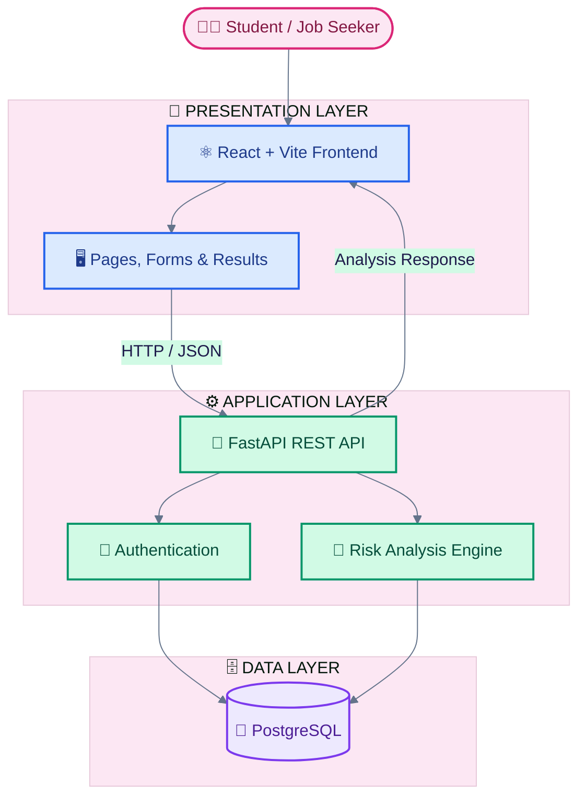
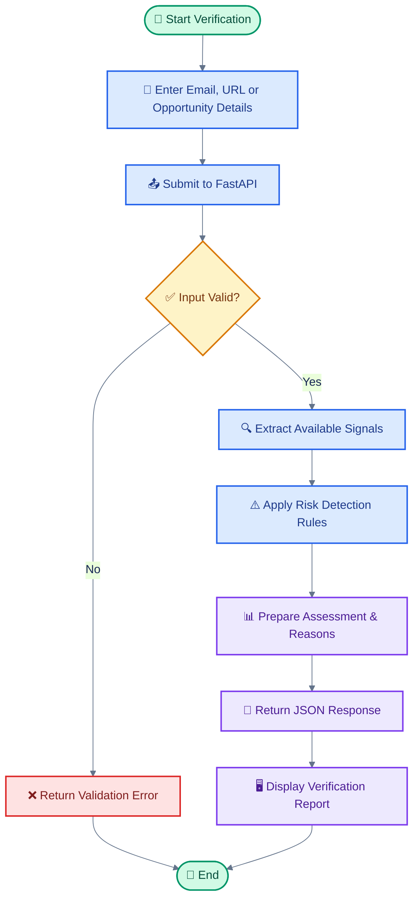
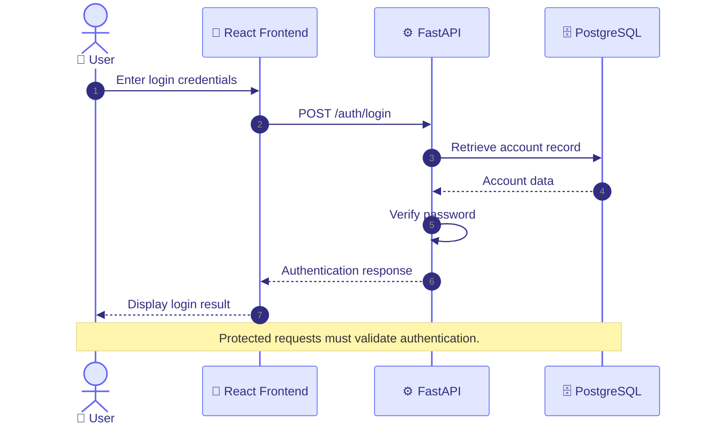

# 🏗️ OfferTrace — System Architecture

  
  
  
  

> 🛡️ **Verify Before You Trust.**
> OfferTrace helps students and job seekers identify potential warning signs in internship offers, recruitment emails, and opportunity URLs.

---

## 📌 1. Architecture at a Glance

OfferTrace follows a layered architecture that separates the user interface, backend business logic, authentication, and database operations.

| Layer             | Technology                       | Responsibility                                   |
| :---------------- | :------------------------------- | :----------------------------------------------- |
| 🎨 Presentation   | React + Vite                     | User interface and application navigation        |
| ⚙️ Application    | Python + FastAPI                 | API requests, validation, and business logic     |
| 🔐 Authentication | JWT                              | Authentication and access to protected endpoints |
| 🔎 Analysis       | Rule-based engine                | Identify configured opportunity risk indicators  |
| 🗄️ Data          | PostgreSQL                       | Store application data                           |
| 🚀 Hosting        | Vercel + planned backend hosting | Public application access                        |

---

## 🌈 2. High-Level System Architecture

### 🔄 How the layers communicate

1. 👩‍🎓 **User:** Enters opportunity information through the website.
2. 🎨 **Frontend:** Collects the input and sends an API request.
3. ⚙️ **Backend:** Validates the request and processes the application logic.
4. 🔎 **Analysis Engine:** Applies the configured risk-detection rules.
5. 🗄️ **Database:** Provides or stores relevant records where required by the implemented workflow.
6. 📊 **Response:** The backend returns a result that the frontend displays to the user.

---

## 🔎 3. Opportunity Verification Workflow

This workflow describes the intended verification process. Actual results depend on the implemented API and configured analysis rules.

---

## 🔐 4. Authentication Workflow

**Security principle:** Password verification and token issuance belong to the backend. Protected endpoints must verify the supplied authentication token before returning private user data.

---

## 🧩 5. Main Application Modules

| Module          | Purpose                                   | Current API             |
| :-------------- | :---------------------------------------- | :---------------------- |
| 🩺 Health Check | Check backend availability                | `/health`               |
| 👤 Registration | Create a user account                     | `/auth/register`        |
| 🔐 Login        | Authenticate a user                       | `/auth/login`           |
| 🪪 User Profile | Retrieve authenticated user information   | `/auth/me`              |
| 🔎 Verification | Analyze supported opportunity information | `/verification/analyze` |
| 🕘 History      | Retrieve verification history             | `/verification/history` |

> These routes describe the current project interface. Their availability in production depends on the backend deployment and configuration.

---

## 🛠️ 6. Technology Stack

| Technology      | Role                                   |
| :-------------- | :------------------------------------- |
| ⚛️ React        | Component-based frontend               |
| ⚡ Vite          | Frontend development and build tooling |
| 🧭 React Router | Client-side routing                    |
| 🎯 Lucide React | Interface icons                        |
| 🐍 Python       | Backend programming language           |
| 🚀 FastAPI      | REST API framework                     |
| 🔑 JWT          | Authentication tokens                  |
| 🐘 PostgreSQL   | Relational database                    |
| 🦊 Git          | Version control                        |
| 🐙 GitHub       | Source code repository                 |
| ▲ Vercel        | Frontend hosting                       |

---

## 🔒 7. Security & Reliability

* 🔐 Keep environment variables and secret keys outside Git.
* 🛡️ Hash passwords securely before storing them.
* 🔑 Validate authentication on protected endpoints.
* 🌐 Use HTTPS for public production traffic.
* 🗄️ Restrict production database access.
* 🧪 Validate input and handle API errors gracefully.
* 🔎 Treat risk assessments as indicators, not definitive proof of fraud.
* 🏢 Encourage independent verification through official company websites.

---

## 🚀 8. Deployment Architecture

The intended production setup separates frontend hosting, backend execution, and database hosting.

```mermaid
%%{init: {'theme':'base','themeVariables':{'primaryColor':'#DBEAFE','primaryTextColor':'#1E3A8A','primaryBorderColor':'#2563EB','lineColor':'#64748B','fontFamily':'Arial'}}}%%
flowchart LR
    USER(["🌍 Public User"])
    VERCEL["▲ Vercel Frontend"]
    BACKEND["🚀 Hosted FastAPI Backend"]
    DATABASE[("🐘 Hosted PostgreSQL")]

    USER --> VERCEL
    VERCEL -->|"HTTPS API Requests"| BACKEND
    BACKEND -->|"Secure Database Connection"| DATABASE

    classDef public fill:#FCE7F3,stroke:#DB2777,color:#831843,stroke-width:2px
    classDef frontend fill:#DBEAFE,stroke:#2563EB,color:#1E3A8A,stroke-width:2px
    classDef backend fill:#D1FAE5,stroke:#059669,color:#064E3B,stroke-width:2px
    classDef database fill:#EDE9FE,stroke:#7C3AED,color:#4C1D95,stroke-width:2px

    class USER public
    class VERCEL frontend
    class BACKEND backend
    class DATABASE database
```

**Deployment status:**

* Frontend: `https://offertrace.vercel.app/`
* Backend: Public deployment and connectivity must be confirmed.
* Database: Production database configuration must be confirmed.

---

## ⚠️ 9. Current Limitations

* Rule-based analysis may miss sophisticated scams.
* Some legitimate opportunities may contain suspicious-looking indicators.
* A low-risk assessment does not guarantee legitimacy.
* Production functionality depends on successful backend and database configuration.
* Users should not rely on OfferTrace as their only source of verification.

---

## 🔮 10. Future Improvements

* 📈 Improve risk detection and evidence explanations.
* 🧪 Expand automated API and frontend tests.
* 📊 Improve report presentation.
* 🌐 Complete and verify public
