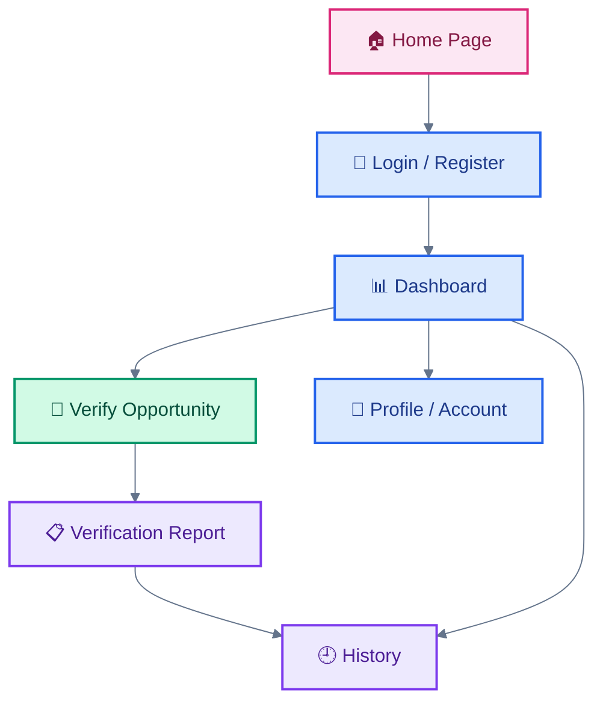

# 🎨 OfferTrace — UI/UX Design System

  
  
  

> ✨ **Design Vision:** A clean, trustworthy, accessible, and professional interface that helps students evaluate online opportunities with confidence.

---

## 🌟 1. Design Goals

The OfferTrace interface is designed around five principles:

| Principle         | Purpose                                                                      |
| :---------------- | :--------------------------------------------------------------------------- |
| 🛡️ Trust         | Present verification information clearly without making unsupported promises |
| 🎯 Clarity        | Make risk indicators and explanations easy to understand                     |
| ⚡ Simplicity      | Keep important actions easy to find                                          |
| 📱 Responsiveness | Support desktop, tablet, and mobile layouts                                  |
| ♿ Accessibility   | Use readable text, clear labels, and understandable feedback                 |

---

## 🎨 2. Color Palette

The following colors are proposed design-system tokens. They should be treated as design guidelines unless the frontend implementation uses the exact values.

| Token      | Color        | Hex       | Suggested Use                     |
| :--------- | :----------- | :-------- | :-------------------------------- |
| Primary    | 🔵 Blue      | `#2563EB` | Main buttons and primary actions  |
| Secondary  | 🟣 Violet    | `#7C3AED` | Highlights and secondary accents  |
| Success    | 🟢 Green     | `#059669` | Positive status indicators        |
| Warning    | 🟠 Amber     | `#D97706` | Caution messages                  |
| Danger     | 🔴 Red       | `#DC2626` | High-priority warnings and errors |
| Background | ⚪ Light Gray | `#F8FAFC` | Page background                   |
| Surface    | ⬜ White      | `#FFFFFF` | Cards and content panels          |
| Text       | ⚫ Slate      | `#1E293B` | Main text                         |

### Color Usage Principle

Colors should communicate meaning consistently. A green indicator must not be presented as proof that an opportunity is genuine, and a red indicator must not automatically be treated as proof of fraud.

---

## 🧩 3. Interface Components

| Component               | Responsibility                                                 |
| :---------------------- | :------------------------------------------------------------- |
| 🧭 Navigation Bar       | Help users move between application sections                   |
| 🪪 Authentication Forms | Collect registration and login information                     |
| 🔎 Verification Form    | Accept supported opportunity details                           |
| 📊 Result Panel         | Present assessment information and detected indicators         |
| 🕘 History View         | Display available previous verification records                |
| 🔔 Feedback Messages    | Communicate success, warnings, validation errors, and failures |
| 🦶 Footer               | Provide relevant project and navigation information            |

---

## 🖥️ 4. Page Structure

*This diagram represents the intended user journey. Actual navigation depends on the routes implemented in the frontend.*

---

## 🔎 5. Verification Screen Guidelines

The verification page should make it easy for users to:

1. 📝 Enter supported opportunity information.
2. 📤 Submit information for analysis.
3. ⏳ Understand when analysis is in progress.
4. 📊 Review the returned assessment.
5. 🔍 Read the warning signs and supporting explanations.
6. 🏢 Find the next steps for independent verification.

### Suggested Result Card

A verification result should prioritize:

* **Assessment:** The result returned by the backend.
* **Detected indicators:** The specific checks that produced relevant findings.
* **Explanation:** Why each finding may matter.
* **Recommended action:** What the user can investigate next.
* **Limitations:** What the application could not confirm.

Only display information actually returned or supported by the backend. Avoid presenting unimplemented features as available functionality.

---

## 📱 6. Responsive Design

| Device      | Design Considerations                             |
| :---------- | :------------------------------------------------ |
| 🖥️ Desktop | Comfortable content width and clear navigation    |
| 💻 Laptop   | Balanced spacing and readable result cards        |
| 📱 Mobile   | Single-column layouts and touch-friendly controls |
| 📲 Tablet   | Flexible card layouts and adaptive spacing        |

Responsive layouts should preserve important content and actions across different screen sizes.

---

## ♿ 7. Accessibility Guidelines

* Use readable font sizes and sufficient contrast.
* Give form fields descriptive labels.
* Provide clear keyboard focus indicators.
* Use meaningful button labels.
* Do not communicate risk using color alone.
* Include useful validation and error messages.
* Provide alternative text for meaningful images.
* Keep interactive elements usable on smaller screens.

---

## 💬 8. User Feedback States

The interface should communicate important states clearly.

| State               | Suggested Message                                      |
| :------------------ | :----------------------------------------------------- |
| ⏳ Loading           | Analyzing your submitted information…                  |
| ✅ Success           | Analysis completed. Review the findings below.         |
| ⚠️ Caution          | Potential warning signs require further investigation. |
| ❌ Validation Error  | Check the submitted information and try again.         |
| 🌐 Connection Error | The service could not be reached. Try again later.     |

These are suggested messages; the actual frontend should display states that correspond to real application behavior.

---

## 🔐 9. Privacy-Focused Design

* Request only the information required for the current feature.
* Avoid displaying passwords or authentication tokens.
* Do not expose one user's verification history to another user.
* Explain limitations of the verification result.
* Encourage users to avoid submitting unnecessary sensitive information.

---

## 🚀 10. Future Design Improvements

* Improve responsive layouts.
* Add genuine application screenshots.
* Refine loading, empty, and error states.
* Improve accessibility testing.
* Add clearer visual explanations for detected risk indicators.
* Maintain consistent reusable components.

---

**💙 Designed for clarity. Built for safer decisions.**

*OfferTrace — Verify Before You Trust.*

